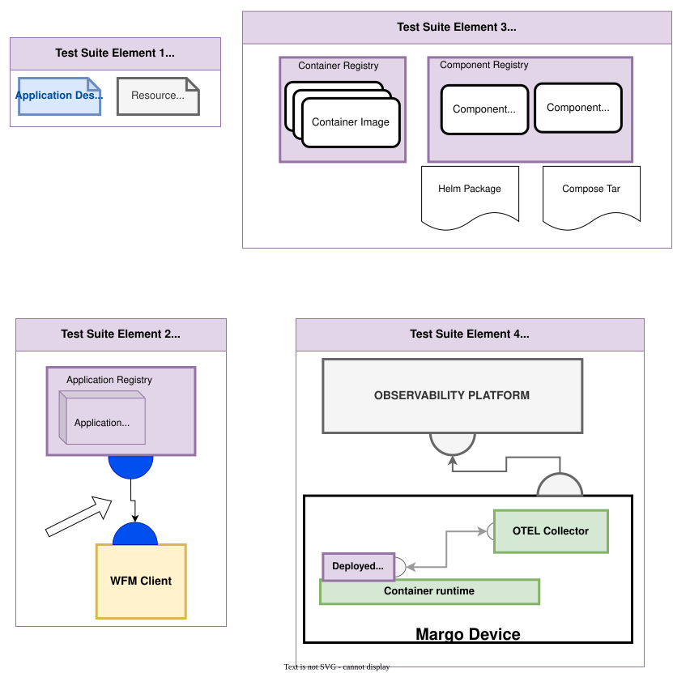

# Application Supplier Conformance Testing
## Focus Area Drawing

## Focus: Application Package + Application Description → hosting components → telemetry.
Major test themes from this persona:

- App Description Conformance — schema validity (`apiVersion: v1`, required fields), `id`/component naming rules, parameter and configuration schema rules (including `allowEmpty`), device eligibility rules (`deviceConstraints`).
- Packaging & Distribution — Application Package manifest and media types, Compose Archive structure and security constraints, `oci://` component references with SemVer `revision`, optional OCI artifact signing.
- Deployment & Lifecycle (with a reference WFM) — install, upgrade, remove, configuration capture/validation.
- [optional]  Observability (OTEL) — Application follows the prescribed pattern (TWG noted “optional but standardized”).
- Extensibility — `custom` deployment types and `x-<name>-extensions` specification extensions.

### Current specification requirements
Specification baseline: **v1.0.0-rc.3 (PR3)**. For the full list of requirements check [App Supplier Conformance Requirements](../persona_based_content/app_supplier_conf_requirements.md).

## Test Suite element 1: Margo Application Package
File(s) to enable the application description package

### Test Items(in scope):

- Margo application description file content:
	- Test suite would only test mandatory elements
	- `apiVersion` MUST be `v1`
	- `id` and component names: lowercase letters, digits, and dashes only; `id` at most 200 characters
	- Configurable attribute schema validation (validation schema types, `allowEmpty` defaults to false)
	- Device eligibility rules: well-formed property/label selectors and match expressions
	- Helm exceptions: charts MUST NOT rely on `lookup`, Helm hooks, or Helm-managed CRDs
- Verify artifact location that the description file is pointing to.
	- Components reference an `oci://` `repository` and a SemVer 2.0 `revision` (no leading `v`, `+` encoded as `_`)
	- What the file is pointing to, is it valid/actionable?
- Verify Margo application description package format
	- Application Package MUST be pushed as an OCI artifact (`artifactType` `application/vnd.margo.app.v1+json`, empty config, one layer per file with Margo media types)
	- Each tag MUST equal the Application Description `metadata.version`
- Signature of this artifact(Authenticity from vendor)
	- Signing as an OCI artifact (for example with cosign) is described but not mandated; informative only
	- https://docs.margo.org/specification/applications/application-registry#authentication-authorization--security

## Test Suite element 2: Application Description Package Interface

### Test Items(in scope):
Application Description Package Interface

- Testing the App Suppliers interface conformance to the OCI distribution specification
- Testing the implementation of the oci artifacts in the registry
- Testing Authentication/access to repo via WFM
	- (NOT MANDATED IN THE SPECIFICATION TODAY)
	- https://docs.margo.org/specification/applications/application-registry#authentication-authorization--security

## Test Suite element 3: Application component verification

**Meta Note**

- Feb/11th: Was decided we should not take on scope that other test infrastructure/strategies already exist. 
- I(Armand) wanted to include these items in our write up, not to declare this testing in scope, but to ensure completeness.
	- If these items are not going to be tested in Margo conformance suite, we should enable users to find where information exists to assist.
	- Additionally, we should explicitly state what is NOT in scope of our conformance suite. 

### Test Items(in scope):

- Compose Archive (OCI artifact)
	- Single-layer OCI artifact with `artifactType` `application/vnd.org.margo.component.compose+json`
	- REQUIRED layer annotations for component type (`compose`) and version (matching the OCI tag and `revision`)
	- Tarball has exactly one top-level directory containing `compose.yaml`
	- Security constraints: no secrets or bind-mount sources, no links or paths escaping the directory, no setuid/setgid/sticky bits; `docker compose publish` output is not allowed
	- https://docs.margo.org/specification/applications/application-registry#compose-component-registry
- Artifact signing for deployment artifacts
	- OCI artifact signing (for example with cosign) is described but not mandated

### Test Items(deemed out of scope):

- Test of Helm Charts to specification
	- https://helm.sh/docs/helm/helm_lint/
- Test of Compose file content to the Compose specification (the Margo Compose Archive structure is in scope above)
	- Doesn't seem to be great tooling readily available for verifying Compose implementations
		- https://github.com/compose-spec/conformance-tests 
- Testing of container images linked via the associated manifest
	- https://github.com/opencontainers/oci-conformance/blob/main/README.md

## Test Suite element 4: Application Components interface and deployment
Within Margo, Application componentsthe device's capabilities enables the WFM to make conscious decisions regarding where to place the applications. It is assumed that when assigning an application to the device, the device itself should have all required services to pull and deploy the artifacts assigned. 

- These items the device(s) need to pull include the following: Helm Packages, Compose Packages, and OCI Containers. 

To ensure vendor interoperability, we need to ensure where the devices house the services to pull their associated application artifacts. 

### Test Items(in scope of Margo??):

- Application Supplier Component interface
	- Helm
		- Local helm operator will pull helm packages defined via the deployment specification
		- Stored in an OCI registry and referenced with an `oci://` `repository` and SemVer `revision`
		- Helm v3 or v4 with Chart `apiVersion` v2
	- Compose
		- Local compose service will pull the Compose Archive from an OCI registry
		- Device and WFM MUST verify the OCI digest and validate the archive before extracting
	- OCI Containers
		- Pulled and verified via the OCI Container runtime(containerd / CRI-O)

## Test Suite element 5: Extensibility

### Test Items(in scope):

- Custom deployment types
	- Deployment profile type `custom` with label-selector eligibility rules and artifacts in an OCI blob
	- https://docs.margo.org/specification/extensibility/custom-runtimes-and-deployments
- Specification extensions
	- Names follow `x-<name>-extensions` (`[a-z][a-z0-9-]*`) and values are objects
	- WFM-targeted extensions at the document root; device-targeted extensions on a deployment profile or component
	- https://docs.margo.org/specification/extensibility/specification-extensions
