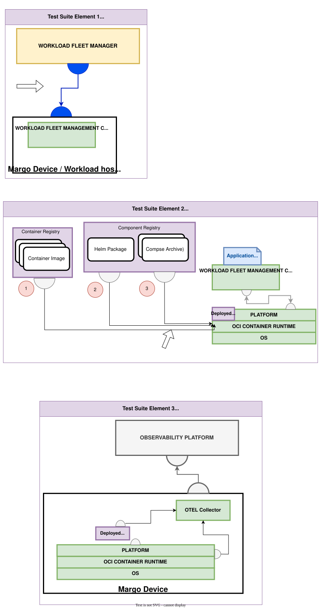

# Device Supplier Testing Outline
## Focus Area Drawing

## Focus: Edge compute device hosting compliant workloads and communication patterns.
Major test themes from this persona:

1. Workload Management Interface Client — desired state interpretation (state manifest, ETag, digest, bundle), status updates (including `adoptedManifestVersion`), and RFC 9457 problem details handling.
2. Runtime Capability — at least one supported deployment type (`helm`, `compose`, or `custom`) and workload runtime (`oci` or `custom`); Helm-enabled devices provide Kubernetes and Helm, Compose-enabled devices provide an OCI container runtime.
3. Compatibility Reporting — device advertises capabilities (`supportedRuntimes`, `supportedDeploymentTypes`, resources) used by WFM to evaluate eligibility rules.
4. Workload Observability checks — lifecycle signals, resource quotas, isolation policies.
5. Identity and Authorization — mutual TLS with X.509-SVIDs, WFM identity profile, trust bundle retrieval and refresh.
6. Gateways — opaque and see-thru gateway capability reporting and gateway deployment status.
(Per PR1 FAQ, device management—firmware/OS—is out of scope until GA; keep those tests gated behind GA1.)

### Current specification requirements
Specification baseline: **v1.0.0-rc.3 (PR3)**. For the full list of requirements check [Device Supplier Conformance Requirements](../persona_based_content/device_supplier_conf_requirements.md).

## Test Suite element 1: Workload Management Interface - Client

End to End workflow verification(Margo means)

- Pulling the application package into WFM
- Ensure the client authenticates with mutual TLS using its X.509-SVID
- Ensuring it can then create an instance deployment specification
- Ensuring edge client can pull from RESTFull API endpoint(deployment specification)
	- State manifest: strictly increasing `manifestVersion`, rollback rejection, durable persistence of `manifestVersion` and ETag
	- Digest verification of every fetched artifact; unsupported algorithm or mismatch aborts the update
- Workload deployment status, including `adoptedManifestVersion`
- Device capabilities. 
- Error handling: honor `Retry-After`, `retryable`, and backoff strategy from RFC 9457 problem details
- WE WOULD OWN THIS TEST INFRASTRUCTURE
- Postman collections
- Need to verify the artifacts being transported to ensure conformance to API artifacts. 

- we would need a mimicked WFM to enable this testing workflow. 

Other ways to verify API contracts. 
.RUST 
.HTTP files

## Test Suite element 2: Workload Deployment and runtime of defined artifacts
Within Margo, Application components the device's capabilities enables the WFM to make conscious decisions regarding where to place the applications. It is assumed that when assigning an application to the device, the device itself should have all required services to pull and deploy the artifacts assigned. 

- These items the device(s) need to pull include the following: Helm Packages, Compose Packages, and OCI Containers. 

To ensure vendor interoperability, we need to ensure where the devices house the services to pull their associated application artifacts. 

Test Items:
1 and 2 can inherit the OCI endpoint verification

- Can pull the helm outlined in deployment specification
- Can then pull the OCI artifacts
- Can then "RUN" the workload

Would need to implement a example application being deployed to ensure it can achieve all necessary steps. 

Testing of the Hosting capabilities that are reported in the other test suite/bucket. 

Helm-enabled devices:

- Kubernetes orchestration platform and Helm v3 or v4 (Chart `apiVersion` v2)
- Deployment approach may use the Kubernetes API (`helm install`) or render and apply templates
- Out-of-band `.Capabilities.APIVersions.Has` support is probationary (informative only)

Compose-enabled devices:

- OCI container runtime (for example Docker or Podman)
- Pull the Compose Archive from the OCI registry, verify the OCI digest, and validate the archive before extracting
- `wait` semantics: report success only when all containers are running

## Test Suite element 3: Application/Platform Observability Support

Test Items:
Deploy example app that is instrumented via OTEL

- Can that example app find the OTEL endpoints via environment variables
- does the Collector properly store the OTEL information
- Ensure the Collector can be configured to export to a example observability platform. 
- Verify the required container runtime metrics are being provided to the local OTEL collector. 

## Test Suite element 4: Identity and Authorization

Test Items:

- Client presents its full X.509-SVID chain over TLS 1.3 (TLS 1.2 fallback per RFC 9325); refuses SSL v3, TLS 1.0, and TLS 1.1
- Supports ECDSA P-256 with SHA-256
- Rejects WFM certificates with the wrong trust domain or `wfm-id`, extra path segments, expired dates, CA flag, multiple URI SANs, or an untrusted chain
- Trust bundle retrieval: validated first connection (no trust on first use), rejects empty bundles and non-HTTPS `trustBundleUri`, replaces rather than merges trust anchors, follows the refresh hint
- https://docs.margo.org/specification/identity/identity-framework

## Test Suite element 5: Gateway Support

Test Items:

- Opaque gateways report aggregated capabilities as a single device
- See-thru gateways report their own manifest before each child manifest using `gateway/child` `deviceId` paths
- Gateway deployment status uses reserved error codes 101–103 and includes the child `deviceId`
- https://docs.margo.org/specification/margo-management-interface/device-capabilities#gateways-considerations

