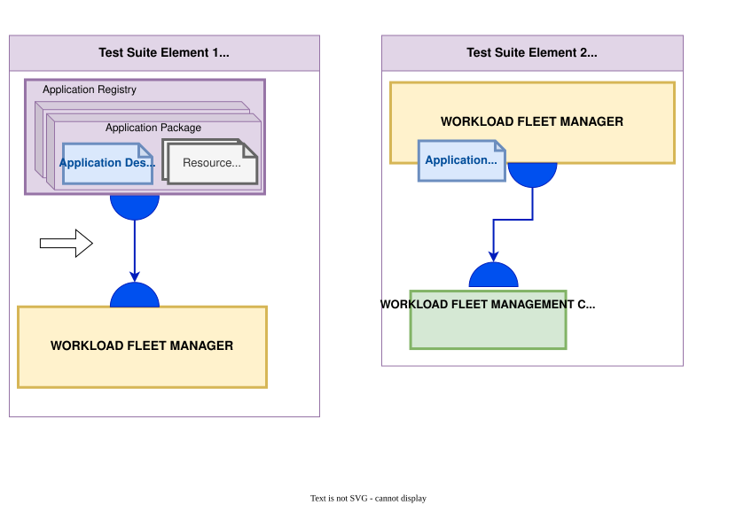

# Workload Fleet Manager Supplier Testing Outline
## Focus Area Drawing

## Focus: Orchestration workflows across mixed devices/apps.
Test groups:
1. Repository Enrollment — application registry + component registries; credential handling.
2. [optional]  Device Enrollment — standalone device and standalone cluster or cluster leader.
3. [optional]  Deployment Workflows — schedule/execute/rollback; configuration capture; compatibility checks.
4. [optional] Telemetry Surfaces — application OTEL + infrastructure metrics visibility.
5. [SUP] Support for Gateway functionality(Managing devices behind the management client)
6. [SUP] Ingestion of all application manifests / enabling templating

### Current specification requirements
For a list of the latest requirements listed in the current pre-draft specification check [WFM Supplier Conformance Requirements](../persona_based_content/wfn_supplier_conf_requirements.md).

## Test Suite element 1: Application Description retrieval / Interpretation

Notes from meeting:
App description being pulled via the WFM
- OCI standard for storing and distributing
- follows notes of the OCI containers getting to the edge in previous.

- Can be driven via OCI verification no need for Postman collections here. 
	- App registry is following our expected format. 
	- We can use a OCI Client (Test the APP Supplier)

- Client side: OCI conformance tests are for the "Server" API. RESTful api. 

Is this a candidate for end to end testing?
- Pull
- verify the application pacakge was pulled.  
- create deployment specification

## Test Suite element 2: Workload Management Interface (interface to device)

Notes from meeting:
End to End workflow verification(Margo means)

- Pulling the application package into WFM
- Ensure enrollment of clients
- Ensuring it can then create an instance deployment speciciation
- Ensuring edge client can pull from RESTFull API endpoint(deployment specification)
- Workload deployment status
- Device capabilities. 
- WE WOULD OWN THIS TEST INFRASTRUCTURE
- Postman collections
- Need to verify the artifacts being trasnported to ensure conformance to API artifacts. 

- we would need a mimicd device to enable this testing workflow. 

# Current SUPs that have an impact on this persona

## Test Suite element 5: Gateway support

## Test Suite element 4: Ingestion of Application manifests / artifacts

